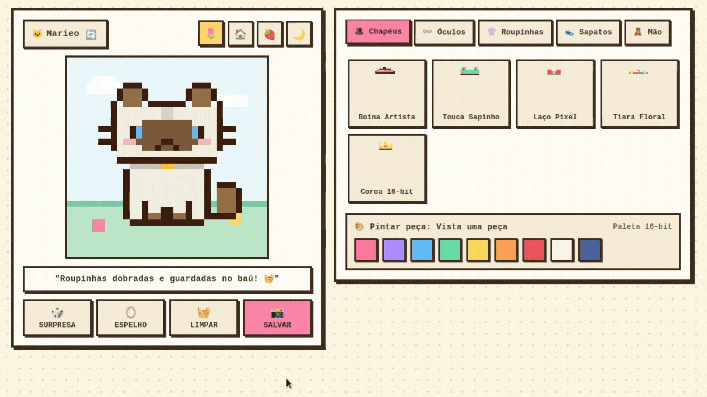

# 🧸 Ateliê dos Bichinhos

<p align="center">
  
</p>

<p align="center">
  
  
</p>

<p align="center">
  ✨ Um pequeno ateliê, muitos bichinhos e infinitas possibilidades de looks! ✨
</p>

---

## 🎀 Sobre o projeto

O **Ateliê dos Bichinhos** é um jogo de personalização inspirado na estética cozy e nos clássicos jogos em Pixel Art 16-bit.

Aqui, você pode escolher seu companheiro, personalizar sua aparência, experimentar combinações de roupas e criar looks únicos em um pequeno mundo cheio de cores e fofura!

O projeto foi desenvolvido com foco na criatividade, interatividade e experiência visual, trazendo uma interface inspirada nos jogos retrô e nos antigos jogos de vestir.

## 🐾 Conheça os bichinhos

Escolha entre três companheiros:

- 🐤 **Calopsita:** uma pequena estrela de topetinho!
- 🐱 **Gatinho:** pronto para desfilar com muito estilo.
- 🐶 **Cachorrinho:** o companheiro mais estiloso do ateliê.

Cada bichinho possui variações clássicas de pelagem ou plumagem, além da possibilidade de personalizar suas cores.

## 👗 Funcionalidades

- 🐾 Escolha e personalização de três espécies de bichinhos.
- 🎨 Paleta de cores para personalizar pelagens e plumagens.
- 🎩 Guarda-roupa com diferentes categorias de acessórios:
  - Chapéus e laços;
  - Óculos;
  - Roupinhas;
  - Sapatos;
  - Acessórios de mão.
- 🌈 Recolorir peças utilizando uma paleta de cores 16-bit.
- 🏡 Quatro cenários diferentes para fotografar seus bichinhos.
- 🎲 Gerador de looks surpresa.
- 🪞 Espelho mágico com efeitos visuais.
- 📸 Álbum de looks no estilo Polaroid, com capacidade para até 24 criações.
- 🔊 Efeitos sonoros inspirados em jogos 8-bit.
- 🌙 Alternância entre tema claro e modo noturno.
- 📱 Interface responsiva para diferentes tamanhos de tela.

## 🛠️ Tecnologias utilizadas

| Tecnologia | Aplicação |
|---|---|
| HTML5 | Estrutura da aplicação |
| CSS3 | Estilização, animações e responsividade |
| JavaScript | Lógica, interatividade e gerenciamento dos elementos |
| SVG | Desenhos dos personagens, roupas e elementos em Pixel Art |
| Web Audio API | Efeitos sonoros Chiptune 8-bit |

## 🎮 Como jogar

1. Inicie o jogo clicando em **Jogar Agora**.
2. Escolha seu bichinho favorito.
3. Defina um nome e personalize suas cores.
4. Entre no ateliê e explore o guarda-roupa.
5. Experimente roupas, acessórios e diferentes combinações.
6. Escolha um cenário para seu bichinho.
7. Salve suas criações no Álbum Pixel!

💡 **Dica:** você também pode criar looks aleatórios com o botão Surpresa!

## 🚀 Como executar

O projeto não precisa de instalação de dependências ou configuração de banco de dados.

1. Faça o clone do repositório:

   ```bash
   git clone URL_DO_REPOSITORIO
   ```

2. Entre na pasta do projeto:

   ```bash
   cd NOME_DO_REPOSITORIO
   ```

3. Abra o arquivo `index.html` diretamente no navegador.

Prontinho! Seu ateliê está aberto. 💗

## 📌 Observação

Esta é uma versão de teste do projeto.

O álbum de looks funciona em memória durante a sessão atual. Portanto, as criações não são mantidas quando a página é fechada ou recarregada. Recomenda-se tirar prints dos looks favoritos!

## 🌸 Desenvolvido com carinho

Projeto desenvolvido como uma experiência de criação e exploração de interfaces interativas, combinando programação, criatividade e estética de jogos retrô.
